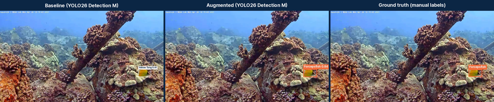
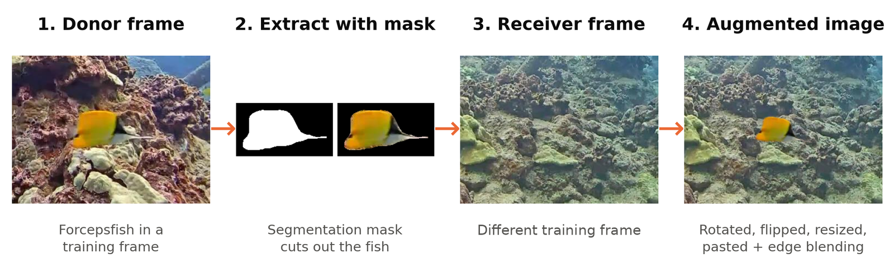
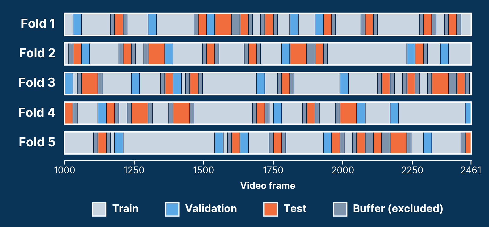

# Fish Classification for Coral Reef Biodiversity Monitoring

Code, results and data for the QUT EGH490 project *Fish Classification for Coral Reef Biodiversity Monitoring*
(Natasha Trikilis, supervised by Dr Scarlett Raine, 2026), in collaboration with Project OceanOasis.

The project evaluates [Ultralytics YOLO26](https://docs.ultralytics.com/) object detection and instance segmentation
models on footage from a stationary reef camera at Kona, Hawaiʻi, and tests whether **targeted copy-paste augmentation**
improves recognition of under-represented fish species.

- **RQ1:** How does species-level performance vary across YOLO-based detection and instance segmentation models of different sizes?
- **RQ2:** How does targeted copy-paste augmentation affect the detection and instance segmentation of under-represented reef fish species?

## Contents

- [Demo videos](#demo-videos)
- [Dataset](#dataset)
- [Method](#method)
- [Main results](#main-results)
- [Repository structure](#repository-structure)
- [Reproducing the results](#reproducing-the-results)
- [Licence](#licence)

## Demo videos



Baseline, augmented and ground truth on held-out test frames (YOLO26 Detection M). Above, the baseline calls a
Forcepsfish a Yellow Tang and the augmented model gets it right.
Videos: [Forcepsfish](media/demo_forcepsfish.mp4) · [Orangespine Unicornfish](media/demo_orangespine_unicornfish.mp4) ·
[Convict Tang](media/demo_convict_tang.mp4). The clips are chosen examples where the baseline misses the fish, not a
random sample; see [`media/`](media/) for details.

## Dataset

**Download:** `kona_reef_fish_dataset_v1.zip` from the
[Releases page](https://github.com/tashtrikilis/fish-classification-coral-reef-biodiversity/releases) (about 240 MB).

- **1,462 consecutive frames** (1000–2461, 1280 × 720) from the [Coral Vision "Kona, Hawaii" dataset](https://universe.roboflow.com/coral-vision/kona--hawaii-dpgl0) on Roboflow Universe, sampled about
  every 2 seconds.
- **4,098 instance masks** across **40 species** (58-class label list), re-annotated in CVAT. Bounding boxes are
  derived from the masks.
- Imbalanced: Yellow Tang is 27% of instances, the top three species 63%, and 20 of the 40 species have fewer than
  20 instances.
- Includes YOLO-seg labels, `data.yaml`, class counts, the fold of every frame and the exact train / val / test / buffer
  image lists for each fold. It also includes the 10 out-of-range donor frames needed to reproduce the augmentation.

## Method

**Targeted copy-paste.** A focus-species fish is cut out of a training frame with its mask, randomly rotated, flipped
and resized, and pasted into another training frame with the same camera view, with edge-only Poisson blending.



**Cross-validation.** Neighbouring frames show the same fish, so the 1,462 frames are split into 30-frame blocks and
the blocks into 5 folds. Each row is one fold: the validation blocks are only used to pick the best epoch, and
frames within 15 frames of a test frame (buffer) are left out of training.



| | |
|---|---|
| **Models** | YOLO26 detection and instance segmentation, sizes S / M / L, COCO-pretrained, `imgsz 1280`, up to 150 epochs (patience 50) |
| **Conditions** | Baseline vs targeted copy-paste augmentation; everything else identical |
| **Focus species** | Forcepsfish (93 instances), Orangespine Unicornfish (77), Convict Tang (33) |
| **Copy-paste** | 23 / 27 / 19 donors taken only from each fold's training frames; random rotation (±20°) and flip; shrunk to sizes drawn from the species' real training sizes; pasted into frames from the same camera view without overlapping other fish; edge-only Poisson blending; 150 synthetic images per species per fold |
| **Evaluation** | 5-fold temporal block cross-validation: 49 blocks of 30 frames, validation (every second block of the next fold) used only for epoch selection, and a 15-frame buffer around test frames. Test-fold predictions are pooled, so every fish is tested once |
| **Runs** | 6 configurations × 2 conditions × 5 folds × 2 seeds = 120 (84.6 H100 GPU-hours) |
| **Statistics** | COCO AP50 (box IoU for detection, mask IoU for segmentation). Paired block bootstrap: 2,000 resamples of the 49 blocks, seeds averaged. Holm–Bonferroni across the 6 configurations and, separately, across the 3 species |

## Main results

Focus-species mean AP50, baseline vs augmented:

| Model | Baseline | Augmented | Change [95% CI] | Holm p |
|---|---|---|---|---|
| Detection S | 0.267 | 0.357 | +0.090 [+0.026, +0.150] | 0.027 |
| Detection M | 0.335 | 0.424 | +0.089 [+0.041, +0.144] | 0.004 |
| Detection L | 0.373 | 0.440 | +0.068 [+0.015, +0.138] | 0.027 |
| Segmentation S | 0.239 | 0.355 | +0.116 [+0.049, +0.176] | < 0.006 |
| Segmentation M | 0.308 | 0.458 | +0.149 [+0.099, +0.217] | < 0.006 |
| Segmentation L | 0.361 | 0.444 | +0.084 [+0.020, +0.148] | 0.027 |

- **RQ1:** any-fish AP50 was similar across models (0.668–0.694), but species-level macro mAP50 was much lower (0.252–0.306).
  Gains from model size were small, and segmentation had no consistent advantage over detection.
- **RQ2:** all six configurations improved significantly. Per species: Convict Tang 0.414 → 0.580 (12/12 runs improved),
  Forcepsfish 0.358 → 0.460 (11/12), Orangespine Unicornfish 0.170 → 0.199 (9/12).
- Non-target and any-fish AP50 changed little. Augmented Detection M (0.424) outperformed baseline Detection L (0.373)
  with 80% of the compute, and augmentation leaves inference cost unchanged.

## Repository structure

```
├── copy_paste_experiment/   experiment code: folds, donor selection, copy-paste, training, evaluation (QUT Aqua / PBS)
├── results/                 cross-validation results for every configuration (seeds 0, 1 and 0+1)
├── supplementary_analysis/  scripts and tables that reproduce every table in the report from the saved predictions
├── media/                   demo videos, README images and the script that makes the videos
└── requirements.txt
```

Each folder has its own README.

## Reproducing the results

```bash
git clone https://github.com/tashtrikilis/fish-classification-coral-reef-biodiversity.git
cd fish-classification-coral-reef-biodiversity
python -m venv .venv && source .venv/bin/activate
pip install -r requirements.txt
```

Versions used: Ultralytics 8.4.126, PyTorch 2.13.0, Python 3.13.5.

1. **Training and evaluation** (GPU cluster): see [`copy_paste_experiment/README.md`](copy_paste_experiment/README.md).
2. **Report tables** (CPU only): download `analysis_bundle_public.tgz` from the Releases page and follow
   [`supplementary_analysis/README.md`](supplementary_analysis/README.md).

## Acknowledgements

- **Footage:** the Aqualink / MEGA Lab reef camera at Kona, Hawaiʻi, via the [Coral Vision "Kona, Hawaii" dataset](https://universe.roboflow.com/coral-vision/kona--hawaii-dpgl0) (Roboflow Universe, CC0).
- **Compute:** QUT eResearch, Aqua HPC.

## Licence

Code: [MIT](LICENSE). Dataset release: images CC0, annotations CC BY 4.0 (see the README inside the zip).
Trained YOLO26 weights, if released, are derived from Ultralytics models (AGPL-3.0).
