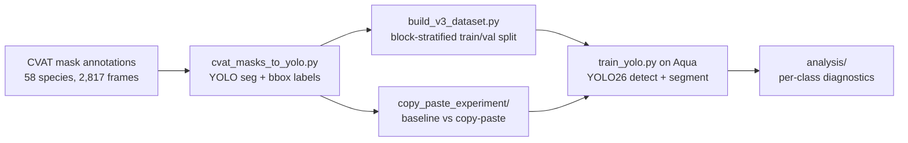
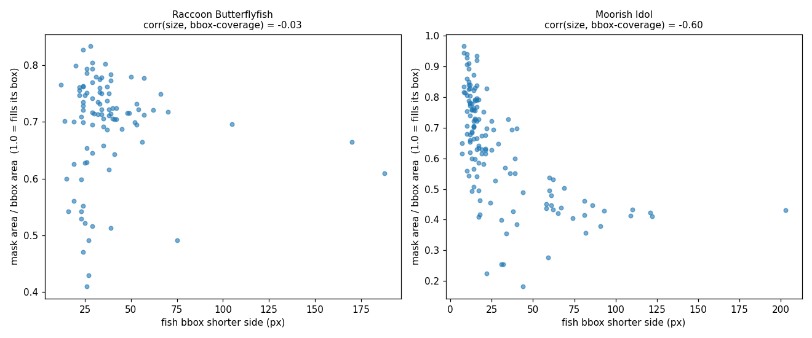
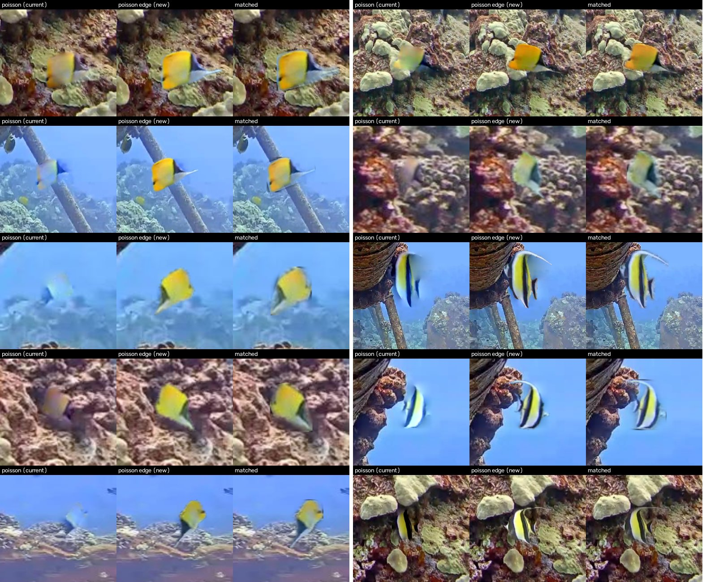
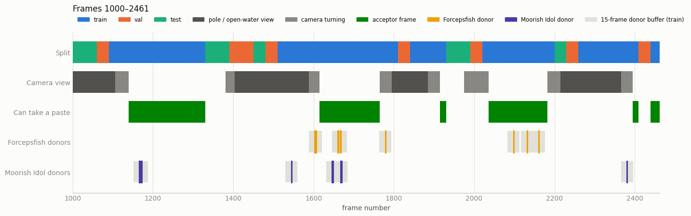

# Fish Classification for Coral Reef Biodiversity

Detecting and segmenting **58 reef fish species** in fixed underwater camera footage from Kona, Hawaiʻi.
The models are [Ultralytics YOLO26](https://docs.ultralytics.com/) detection and instance-segmentation
models, trained on QUT's Aqua HPC.

The project looks at why some species are much harder to detect than others. It tests instance count,
object size, taxonomic family and same-species crowding as explanations. It also tests whether targeted
**copy-paste augmentation** helps under-performing species.

QUT EGH490 research project.

---

## Contents

- [Overview](#overview)
- [Repository structure](#repository-structure)
- [Getting started](#getting-started)
- [Data](#data)
- [Running the pipeline](#running-the-pipeline)
- [Copy-paste augmentation experiment](#copy-paste-augmentation-experiment)
- [Analysis](#analysis)
- [Key findings so far](#key-findings-so-far)
- [References](#references)
- [Licence](#licence)

## Overview



- **Footage:** a fixed reef camera, 1280×720, about 94 minutes sampled to 2,817 frames.
- **Labels:** every fish instance-masked in CVAT, across 58 species. The distribution is very long-tailed: Yellow Tang has over 1,000 instances, and many species have fewer than 10.
- **Models:** YOLO26 nano to medium at full resolution (`imgsz 1280`), logged to Weights & Biases.
- **Evaluation:** frames are split in contiguous time blocks, not randomly, because near-identical neighbouring frames would otherwise leak between train and test.

## Repository structure

```
├── data/                     labels only, no footage (see data/README.md)
│   ├── cvat/annotations.xml       CVAT 1.1 mask export
│   └── labels_yolo_seg/           Ultralytics YOLO-seg export (latest labels) + class list
├── pipeline/                 dataset building and training
│   ├── cvat_masks_to_yolo.py      CVAT masks -> YOLO polygon + bbox labels, donor eligibility
│   ├── build_v3_dataset.py        block-stratified train/val split
│   ├── restratify_split.py        re-split an existing dataset so classes appear on both sides
│   ├── filter_topk_classes.py     top-10 species subset
│   ├── copy_paste_augment.py      class-balancing copy-paste (equalize / minority-cap modes)
│   ├── single_paste_demo.py       one deterministic paste, for figures
│   ├── train_yolo.py              train detect or segment, writes per-class metrics
│   ├── run_v3_pipeline.sh         end-to-end v3 pipeline
│   └── jobs/                      PBS job scripts for QUT Aqua
├── analysis/                 why do some species underperform?
│   ├── analyze_class_performance.py   instance count and size vs recall
│   ├── analyze_family_confusion.py    taxonomic family effects
│   └── analyze_class_crowding.py      same-species crowding / schooling
├── copy_paste_review/        choosing species, blend method, donors and acceptor frames
├── copy_paste_experiment/    targeted copy-paste experiment (Forcepsfish, Moorish Idol)
├── docs/figures/             figures used in this README
└── legacy/                   earlier v1/v2 notebooks, configs and job scripts
```

## Getting started

Python 3.10 or newer.

```bash
git clone https://github.com/<your-username>/fish-classification-coral-reef-biodiversity.git
cd fish-classification-coral-reef-biodiversity
python -m venv .venv && source .venv/bin/activate
pip install -r requirements.txt
```

Then place the frames in `full_dataset/` at the repository root, as described in [`data/README.md`](data/README.md).
Every script and notebook looks for them there.

## Data

The repository holds the **annotations only**. The source footage (2,817 JPEG frames, about 455 MB) isn't included.
See [`data/README.md`](data/README.md) for the label formats, the class list and the expected folder layout.

## Running the pipeline

The full v3 pipeline goes from CVAT export, through the split, to class-balanced copy-paste datasets:

```bash
cd pipeline
./run_v3_pipeline.sh ../full_dataset 1000 1771      # images dir, first frame, last frame
```

Training on QUT Aqua (PBS) is run from `pipeline/` so the job scripts find `train_yolo.py`:

```bash
cd pipeline
qsub jobs/job_seg_v3_equalize_m.pbs
qstat -u $USER
```

Or run one training job directly:

```bash
python train_yolo.py --task segment --data data_seg_v3.yaml --model yolo26m-seg.pt --imgsz 1280 --epochs 150
```

Each run writes `per_class_metrics.csv` (precision, recall, F1 and mAP per species), which the analysis scripts read.
Before submitting, edit the `#PBS -M` email line in each job script.

## Copy-paste augmentation experiment

[`copy_paste_experiment/`](copy_paste_experiment/) is a self-contained, controlled experiment. It trains
**baseline vs copy-paste** for both detection and segmentation on an identical train/val/test split, and reports
per-species results for **Forcepsfish** (a documented weak performer) and **Moorish Idol**.

- **Donors:** only manually approved instances (large and unoccluded), reviewed in [`copy_paste_review/`](copy_paste_review/). Small instances were left out because their masks are coarse and their colours washed out by distance.


*Mask area ÷ box area against fish size. Small Moorish Idol masks nearly fill their box, so they're blocky, while large ones follow the fish's outline. Raccoon Butterflyfish shows no such trend.*

- **Acceptors:** training frames in an allowed camera view, chosen by manual review. The paler pole / open-water view is excluded.
- **Leakage guard:** frames within 15 frames (about 30 s) of any donor are forced into training, so the model can't benefit from having seen a test fish.
- **Blend:** edge-only Poisson. Plain Poisson recoloured whole fish from their background (below).


*Same placements, three blends: plain Poisson (left of each trio), edge-only Poisson (middle, used), and LAB-matched feathering (right).*


*Where train / val / test, the excluded camera view, acceptor frames and donors fall across frames 1000–2461.*

Run it on Aqua with `bash submit_all.sh`. W&B logs per-epoch metrics for each focus species and the final test-set
numbers. See [`copy_paste_experiment/README.md`](copy_paste_experiment/README.md) for the full method and instructions.

**Results:** *to be added once the Aqua runs complete* (`runs/comparison/comparison.md`).

## Analysis

```bash
python analysis/analyze_class_performance.py --metrics-csv path/to/per_class_metrics.csv \
    --labels-dir path/to/labels/train --data-yaml path/to/data.yaml
python analysis/analyze_family_confusion.py  --metrics-csv path/to/per_class_metrics.csv --data-yaml path/to/data.yaml
python analysis/analyze_class_crowding.py    --labels-dir path/to/labels/train --data-yaml path/to/data.yaml \
    --metrics-csv path/to/per_class_metrics.csv
```

## Key findings so far

These come from the full 58-species detection run (v3 split, equalize copy-paste) unless noted.

- **Instance count matters mainly at the bottom.**
  - Correlation between instance count and recall is r = 0.12 within the top-10 species, but r = 0.48–0.62 across all 58.
  - Below roughly 10–20 instances a species can't be learned at all.
  - Above that, other factors dominate: Orangeband Surgeonfish (201 validation instances) reaches only 0.51 recall, while Moorish Idol (31) reaches 0.71.
- **Object size is ruled out** (r = −0.19). Yellow Tang has the smallest average box but the best recall (0.83).
- **Taxonomic family has no effect overall.** Species sharing a family with others perform no worse than species without relatives in the dataset.
- **Same-species crowding explains Orangeband Surgeonfish.**
  - 24.5% of its instances overlap another of its kind, compared with 3–5% for comparable surgeonfish.
  - It's the most crowded of the four abundant species and has the worst recall.
  - A naive dataset-wide correlation pointed the other way because rare species can't register as crowded. Restricting to adequately sampled classes fixed it.
- **Fewer classes means higher precision.** Restricting to the top-10 species raised Yellow Tang precision from 0.76 to 0.91, consistent with the "inter-class dependency" effect described by Wille et al. (2026). The two runs used different splits, so this isn't a controlled comparison.

## References

- Ultralytics YOLO26: https://docs.ultralytics.com/
- Ghiasi, G. et al. (2021). *Simple Copy-Paste is a Strong Data Augmentation Method for Instance Segmentation.* CVPR.
- Pérez, P., Gangnet, M., & Blake, A. (2003). *Poisson Image Editing.* ACM SIGGRAPH.
- Wille et al. (2026). *Are All Marine Species Created Equal? Performance Disparities in Underwater Object Detection.* WACV. [arXiv:2508.18729](https://arxiv.org/abs/2508.18729)

## Acknowledgements

- **Footage:** the Aqualink / MEGA Lab reef camera at Kona, Hawaiʻi.
- **Compute:** QUT eResearch, Aqua HPC.

## Licence

Code is released under the [MIT Licence](LICENSE). The licence covers the code and annotations in this repository,
not the source footage.
